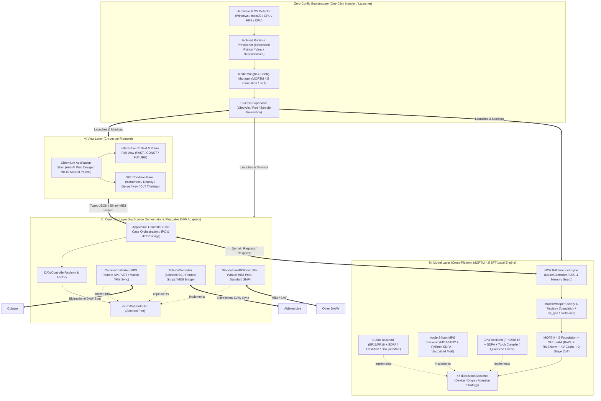
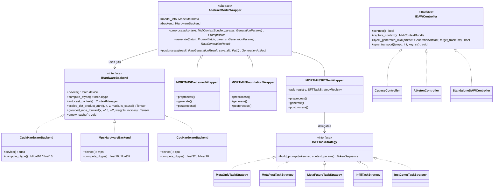
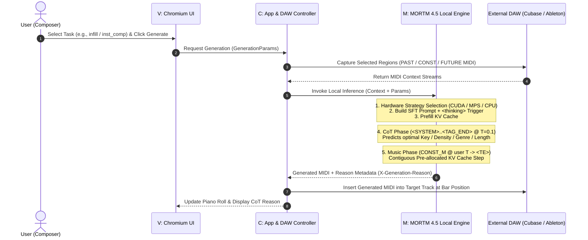

# COMPASS AI — System Concept & MVC Architecture

本ドキュメントは、記号的音楽基盤モデル **MORTM 4.5 Foundation (SFT)** をあらゆるローカル環境（NVIDIA GPU / Apple Silicon Mac / CPU）で高速実行し、Chromiumベースのフロントエンドおよび各種DAW（Cubase、Ableton Live等）とシームレスに連携する **COMPASS AI** の全体概念図です。

---

## 1. 全体概念図 (MVC + ワンクリックインストーラー統合構造)

エンジニアリング知識を持たないエンドユーザーがインストーラー1つで環境構築から起動まで完結でき、MVC（Model-View-Controller）の責務分離とSOLID原則（依存性逆転の原則・開放閉鎖の原則）に完全準拠した全体構造です。

---

## 2. Model (M): マルチプラットフォーム・高速推論エンジンの概念図

`flash-attn` や特定CUDAバージョンへのハードコード依存を完全に排除し、実行環境（CUDA / MPS / CPU）に応じて最適な計算カーネル・データ型（`bfloat16` / `float16` / `float32`）・KVキャッシュを注入する Strategy パターン設計です。

```mermaid
flowchart LR
    subgraph InputDomain["1. Domain Input (Value Objects)"]
        GenMeta["GenerationRequest (Task / Program / Density / Genre / Key / CoT)"]
        MidiCtx["MIDI Contexts (PAST_M / CONST_M / FUTURE_M)"]
    end

    subgraph PromptBuilder["2. SFT Prompt & Token Pipeline"]
        TaskRouter["SFT Task Strategy (meta / meta_past / meta_future / infill / inst_comp)"]
        SysBuilder["Partial / Full System Tag Builder + <thinking> Trigger"]
        Tokenizer["Metric-Oriented Tokenizer (Vocab 700 / 96th Subdivision Grid)"]
        TaskRouter --> SysBuilder --> Tokenizer
    end

    subgraph RuntimeStrategy["3. Hardware Abstraction & Execution Strategy"]
        DevicePolicy["RuntimePolicyResolver"]
        DevicePolicy -->|"NVIDIA GPU"| CudaExec["CUDA Strategy (BF16/FP16 + SDPA/Flash + Pre-allocated KV Cache)"]
        DevicePolicy -->|"Apple Silicon"| MpsExec["MPS Strategy (FP16/FP32 Safe Cast + Contiguous SDPA KV Cache)"]
        DevicePolicy -->|"No GPU (CPU)"| CpuExec["CPU Strategy (FP32/BF16 + Dynamic Int8/SDPA + Fast Top-P)"]
    end

    subgraph TwoStageDecode["4. Two-Stage Autoregressive KV-Cache Decoding"]
        Prefill["Phase 1: Parallel Prompt Prefill (Batched / Unpadded or Masked SDPA)"]
        CoTDecode["Phase 2a: CoT Meta Prediction (<SYSTEM>..<TAG_END> @ cot_temperature=0.1)"]
        MusicDecode["Phase 2b: Musical Token Generation (CONST_M @ temperature -> <TE>)"]
        Prefill --> CoTDecode --> MusicDecode
    end

    subgraph OutputDomain["5. Post-Processing & Output"]
        ReasonParser["CoT Reason Extractor (X-Generation-Reason JSON)"]
        DeConverter["MIDI De-Converter (PrettyMIDI / SMF Stream)"]
    end

    InputDomain --> PromptBuilder
    PromptBuilder --> RuntimeStrategy
    RuntimeStrategy --> TwoStageDecode
    TwoStageDecode --> OutputDomain
```

---

## 3. OOP クラス階層概念図 (SOLID原則・デザインパターン構造)

`oop-extensible-craft` プロトコルに基づき、条件分岐の乱立を排し、抽象インターフェース（DIP）とレジストリ/ファクトリ（OCP）で構成されるクラス設計です。

---

## 4. シーケンス概念図 (DAW連携〜2段階CoT推論〜DAW反映フロー)

---

## 5. 実装モジュール構成 (MVC Layer Mapping)

- **Model (`M` — Local MORTM 4.5 Engine)**:
  - `mortm/models/mortm.py`, `mortm/models/modules/` (`backend.py`, `attention.py`, `layers.py`, `lora_layers.py`)
  - `models/mortm/mortm45d.py`, `models/mortm/mortm45.py`, `rapper.py`, `model.py`, `app.py`, `main.py`
- **Controller (`C` — Pluggable DAW Controller Layer)**:
  - `frontend/src/controllers/IDawController.ts`, `frontend/src/controllers/DawControllerRegistry.ts`
  - `frontend/src/controllers/DemoPianoRollController.ts`, `frontend/src/controllers/ExternalDawAdapters.ts`
  - `frontend/src/domain/` (`MidiNote.ts`, `MeasureRange.ts`, `DawTrack.ts`, `commands/`, `midi/StandardMidiCodec.ts`)
- **View (`V` — Chromium TypeScript + Tailwind CSS Studio UI)**:
  - `frontend/src/components/` (`CompassLogo.tsx`, `BootSplashScreen.tsx`, `ResonanceCircleCanvas.tsx`, `ControlPanelView.tsx`, `PianoRollView.tsx`, `MidiTrackImportModal.tsx`)
  - `frontend/src/App.tsx`, `frontend/src/services/WorkspaceSyncBus.ts`, `frontend/src/audio/WebAudioEngine.ts`
  - `frontend/electron/main.cjs`, `frontend/electron/preload.cjs`, `start_compass_ai.bat`
